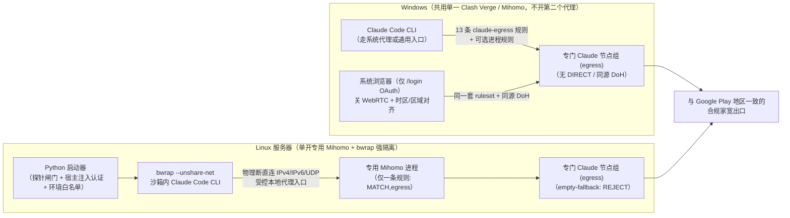

# 极简 Safety Claude

[](LICENSE)
[-orange.svg)](https://wiki.metacubex.one/)
[](https://www.python.org/)
[](.github/workflows/ci.yml)

一套面向 **Claude Code CLI（几乎纯 CLI）+ 正规 Google Play Pro 订阅** 的极简安全实践与排障思路。

> [!IMPORTANT]
> **先认清边界：本地技术防护做的只是「防手贱」和「兜底」，真正能不能长期存续，最终看你的使用情况与上游环境。**
>
> - **配置能做什么（防手贱 + 兜底）**：防规则漏列、防 DNS 泄漏、防节点失效时静默直连、防同机切号串 Cookie/Token、防浏览器 OAuth 登录和 CLI 出口劈叉。
> - **配置救不了什么（决定存续的根本）**：
>   1. **上游环境与 IP 底子**：是否处于官方支持地区、所用家宽/ISP ASN 是否干净（廉价机房 IP / 商业共享 VPN 本身就会触发风控）、Google Play 账单与出口地区是否一致。
>   2. **真实使用方式**：Anthropic 明确要求消费级订阅 OAuth **仅限本人用于官方原版应用与未修改的官方 Claude Code CLI**——严禁接入第三方套壳转发、严禁多人共享、严禁跑高频自动化脚本，并需遵守 5 小时/周配额及 Usage Policy。
>
> **一句话**：不要盲信一份“死配置”，也不要完全轻信 AI Agent 给的建议——自己懂原理、会验证，技术只负责不让你因低级失误挂在起跑线上。

---

## 一、先懂原理：为什么必须做这 4 件事（P0 核心）

配置之前，先搞明白「**做对了保什么、做错了会怎样**」：

### 1. 为什么「一号一机」比代理规则更底层？
- **原理**：代理只管网络出口 IP，**管不住终端本地状态**（浏览器 Cookie、本地 OAuth Token、系统/浏览器指纹）。
- **现实**：哪怕代理出口完美，只要你在同一台设备或同一个浏览器 Profile 里来回登录切换两个 Pro 账号，本地痕迹依然会把两个号关联在一起。
- **做法**：严格实行 **1 个 Pro 账号 = 1 台独立机器（或完全隔离的 OS 用户/沙箱环境）**，双号和跨端（Windows + Linux）统一对齐同一合规地区的家宽出口策略。

### 2. 为什么 Windows 共用代理、Linux 才单开专用 Mihomo？
- **核心区分（Windows 共用 vs Linux 专用）**：
  - **Windows 端（共用单一 Clash Verge / Mihomo 实例）**：不开第二个代理服务器，而是在现有代理里给 Claude 分出一个**专门的节点组（`egress`）**，靠持久化的 13 条精准域名规则集（外加进程规则兜底）把 CLI 与 `/login` 浏览器的流量一起收口到该节点组。
  - **Linux 服务器（单开一个专用 Mihomo 代理进程 + `bwrap` 沙箱）**：因为要在服务器上长期跑自主 CLI 任务，专门起一个只服务沙箱的 Mihomo 进程，规则极简到只有一条 **`MATCH,egress`**，彻底不依赖域名清单（天然覆盖未来任意 MCP/工具域名），再用 `bwrap --unshare-net` 从内核层物理封死直连旁路。
- **各自边界**：Windows 共用代理胜在轻量零额外进程，但静态域名清单无法覆盖未来任意第三方 MCP 域名；Linux 专用进程 + 命名空间能全量接管且防绕过，适合高强度跑任务。

### 3. 为什么「分流规则对了，DNS 还是可能漏」？
- **最常被忽略的机制**：流量规则决定「TCP 连哪个代理」，DNS 决定「域名怎么解析成 IP」。
  1. **规则顺序决定谁先触发解析**：如果在 `RULE-SET` 之前出现了基于 IP 的规则（如 `GEOIP,CN`、`IP-CIDR` 且没加 `no-resolve`），内核为了匹配那条 IP 规则，会**提前发起真实 DNS 解析**——此时你的分流规则还没机会生效。
  2. **分流与 DNS 必须同源**：流量规则加了 `clau.de`，但 `nameserver-policy` / `fake-ip-filter` 漏了它，就可能导致本地/国内 DNS 先解析了该域名。
  3. **看清「经出口 DoH」的真相**：配置 `https://1.1.1.1/dns-query#egress` 的含义是「本地 Mihomo 穿过代理去查 Cloudflare」，**不等于**「远端代理节点用自己的系统 DNS 解析」。最理想的做法是 HTTP CONNECT / SOCKS5 直接把原始域名交给远端落地节点解析，同时用规则集同源的 DoH 做安全兜底。

### 4. 为什么「极度稳定」和「自动故障切换」天然冲突？
- **理解 `select` vs `fallback`**：
  - `fallback` / `url-test` 追求**不断网**，但主节点一波动就会自动切到备用节点——**出口 IP 在会话中途跳变**。
  - `select`（手动选定）追求**IP 恒定**，主节点短暂波动时宁可断连重试也不擅自换 IP。
- **硬底线**：无论用哪种，专门服务 Claude 的节点组里**绝对禁止出现 `DIRECT` 或 `GLOBAL`**，并且必须配置 `empty-fallback: REJECT`，防止所有节点不可用时静默降级直连。

---

## 二、实战关键经验（P1，环境、浏览器与 Google Play）

### 1. 双 ISP 家宽凌晨 03:00 `/16` 重置与地区选线经验
- **同 `/16` 重置是正常家宽现象**：家宽 PPPoE 重拨连回同一区域 BRAS 地址池时，新 IP 本来就会落在同一 `/16` 段与同一 ISP ASN 下（如凌晨 03:00 定时重置）。白天长会话粘性不变，与风控拦截的「高频轮换代理」不同；唯一代价是 **02:55–03:10** 会瞬断重连（避开此窗口跑长任务即可，自建 DDNS 把 TTL 设低如 60s），**但仍受同段邻域历史声誉影响**。
- **台湾家宽置信度差异**：若走台湾家宽出口，实操中**除中华电信 HiNet（AS3462）外，其余不少台湾运营商或“伪家宽”线路在主流 IP 情报库里的纯住宅置信度明显偏低**（易被识别为商用/混合池或受邻居滥用连累）。
- **`select` vs `fallback`**：如果两条不同 ISP 挂了 `fallback`，凌晨主线重拨瞬断会立刻切去第二条 ISP，造成 **ASN 和 `/16` 同时跳变**并在恢复后二次回切；追求极稳优先选手动 `select`。

### 2. CLI 代理环境变量与 OAuth `NO_PROXY` 注意事项
- **必须配 `NO_PROXY`**：Claude Code `/login` 时会在本机回环启动临时回调服务。使用代理环境变量时务必保留 `NO_PROXY=localhost,127.0.0.1,::1`，否则授权回调必卡死，且本地 MCP Server 也会被误送进代理。
- **协议与生效时机**：官方 Claude Code **仅原生支持 `http://` / `https://` 代理（不支持 `socks5://`）**，且代理环境变量**只在启动时读取一次**（修改后需重启会话生效）。

### 3. 简单的浏览器与 Windows 环境对齐经验（`/login` 等场景）
虽然几乎只用 CLI，但授权登录或偶尔开网页时，浏览器与系统指纹别和代理地区打架：
- **关闭 WebRTC**：防止浏览器通过 WebRTC STUN 绕过 HTTP 代理暴露真实本地/公网 IP（可在浏览器扩展或隐私设置中禁用非代理 UDP / WebRTC IP 暴露）。
- **对齐浏览器时区**：确保浏览器报告的时区与代理出口所在地区一致。
- **对齐 Windows 时间与区域**：打开 Windows `设置 → 时间和语言`，将 **日期和时间（时区）**、**区域 → 国家或地区** 与 **区域格式** 调整为与目标出口一致的地区和对应语言格式（这属于终端环境一致性；切勿误信网上“全局代理 NTP”的说法，详情见文末误区）。

### 4. Google Play 订阅与双号实用小技巧
1. **三者一致**：**Google Play 商店地区 / 支付账单地区 / 日常使用出口 IP** 保持同一合规地区，避免跨区账单与异地 IP 叠加触发欺诈风控。
2. **双号手机端物理/系统隔离**：如果需要开两个独立的 Google Play 订阅号，可利用部分安卓手机自带的**「手机分身 / 第二空间」（系统级独立用户空间，非普通应用双开）**开两个彼此隔离的 Google Play，分别绑定两个独立账号与环境，从支付端到桌面/服务器 CLI 端彻底落实「一号一机」。

### 5. Linux 沙箱的「信任边界」要自己心里有数
- 用 `bwrap --unshare-net` 隔断直连后，容器内无法直接连外网。但如果你为了日常跑实验，在容器内保留了连回宿主机的桥接（例如宿主机 `tmux` Unix Socket 或特定本地端口转发），**通过这类桥接跑在宿主机上的子进程就已经脱离了网络命名空间和目录遮蔽约束**。
- 个人可信项目可以自觉接受并记录这个边界；如果哪天要跑不可信的陌生代码，必须彻底关闭通用桥接入口（如 `run-shell` / `source-file` 等任意参数转发），并审计所有映射端口。

---

## 三、别轻信任何配置或 Agent：5 步自己验真假

无论配置是你自己改的，还是 AI Agent 帮你生成的，上线前**自己动手核对这 5 项**（不要只看“能打开网页”就以为没问题）：

1. **查“CLI 自己认没认到代理”**：启动 Claude Code 后直接输入 **`/status`** 查看当前网络代理状态（排障时可用 **`claude --debug`** 看连接与 OAuth 细节）。
2. **查“改在了哪”**：Clash Verge 里直接改 `clash-verge.yaml` 是无效的（下次刷新订阅就会被覆盖）。确认改动位于 **Merge / Prepend Rules / DNS 覆写** 持久层，且本地如果有启动守护/防火墙脚本，规则前缀与哈希已同步更新。
3. **查“规则排在谁前面”**：去内核 `/rules` 或面板搜 `claude-egress`，亲眼确认它排在 `geosite-category-ai`、`GEOIP` 和 `MATCH` **之前**。
4. **查“真实连接命中链”**：发一个不带账号凭据的测试请求（例如访问 `https://api.anthropic.com` 或 `https://clau.de`），打开 Mihomo **Connections 面板**（或运行 `python scripts/verify_mihomo.py --probe`）：
   - 看 `Rule` 列是不是明确显示 `claude-egress`（或 Linux 专用 Mihomo 的 `MATCH`），而不是 `category-ai` / 通用规则？
   - 看 `Chains` 里是不是干净的 `[目标家宽节点, 专门节点组]`，确认没有混入 `DIRECT`？
5. **反问 Agent 3 个问题（防被糊弄）**：
   - *「你有没有图省事给我加 `DOMAIN-KEYWORD,claude` / `datadog` / `sentry`？」*（有的话立刻删，会误伤大量其他开发软件）
   - *「这个节点组里有没有隐藏的 `DIRECT`、`GLOBAL` 或跨区备用节点？」*
   - *「你是不是以为我在 Windows 也开了第二个代理进程？我的 Windows 其实是共用单一 Clash Verge，只拆了一个专门节点组。」*

---

## 四、实际跨平台架构与配置参考



### 1. Windows（实际方案）：共用 Clash Verge + 专门 `egress` 节点组

日常只运行**一个** Clash Verge / Mihomo，不另开第二个代理进程；把本仓库规则模板放进订阅的**持久增强层**即可：
- **专门节点组**：在订阅或 Merge 里保留一个只含合规家宽节点的组（如 `egress`），**禁含 `DIRECT`**，建议 `empty-fallback: REJECT`。
- **Merge 扩展合并**：参考 [rulesets/clash-verge-merge.example.yaml](rulesets/clash-verge-merge.example.yaml)（注入 13 条精准 `claude-egress`）。
- **Prepend 前置规则**：参考 [rulesets/clash-verge-prepend.example.yaml](rulesets/clash-verge-prepend.example.yaml)（排在 `geosite-category-ai` 之前，按需附带 `PROCESS-NAME` 进程兜底）。
- **DNS 覆写**：参考 [rulesets/dns-config.example.yaml](rulesets/dns-config.example.yaml)（补齐 13 项经 `egress` 的 DoH 与 `fake-ip-filter`）。
- **一键运行态核验**（零外部依赖，直接查 Mihomo API 核对以上全部条件）：
  ```bash
  python scripts/verify_mihomo.py --api http://127.0.0.1:9097 --group egress --probe
  ```
  > 最小化回退：只需删除 Prepend 里的 `RULE-SET,claude-egress,egress`、Merge 里的 `claude-egress` provider 及对应 DNS 项并重载，不要直接拿旧快照覆盖整份配置。

### 2. Linux 服务器（实际方案）：独立专用 Mihomo 进程 + `bwrap` 隔离

在 Linux 服务器上为 Claude Code **专门跑一套独立的 Mihomo 进程**（绑定回环监听并开启代理认证与控制器密钥），配合 `bwrap` 实现系统级网络隔离：
- **进程启动链**：`终端管理器 → Python 启动器 → bwrap → 内侧桥接 → Claude Code`
- **4 个关键隔离控制点**：
  1. **网络命名空间**：`bwrap` 启用 `--unshare-net --unshare-user --unshare-pid --cap-drop ALL`，内核直接阻断容器内一切普通 IPv4 / IPv6 / UDP 直连（防止子进程忽略代理变量直接外连或私自发 UDP DNS）。
  2. **凭据与秘密隔离**：代理认证密码由宿主机侧注入，容器内拿不到真实代理密码、订阅 URL 或 Mihomo 控制器密钥；环境变量走白名单，敏感目录做挂载遮蔽。
  3. **专用内核极简规则**：该专用 Mihomo 配置规则**只写一条 `MATCH,egress`**，不要退化成域名白名单；同时配合节点同步脚本校验白名单节点名、协议类型、关闭 `skip-cert-verify` 与 `dialer-proxy`，并在生效前跑 `mihomo -t`。
  4. **探针与容错边界**：若有归属地/可用性探针闸门，启动时 `unknown` 保持拦截；放行后若短时探测 `unknown`，应记录最后成功时间并设定**最大失联信任时长（Max Stale TTL）**，超时即阻断新建连接。

### 3. 可选工具：`portable/claude-routing` 离线配置生成器

如果你不想使用 Clash Verge 的 Merge/Prepend，或者未来希望在独立副本里验证规则与 DNS 同源合并（也支持可选 `--dedicated-port` 独立端口模式），可以使用仓库附带的离线脚本 [portable/claude-routing/compose.py](portable/claude-routing/compose.py)：
- 它内置了严格校验（节点存在性、禁止 `DIRECT`/`GLOBAL`、禁止 `skip-cert-verify: true` 与 `dialer-proxy`、强制 `fake-ip` + `rule` 模式），不合规直接报错拒绝输出：
  ```powershell
  pip install -r portable/claude-routing/requirements.txt
  python portable/claude-routing/compose.py input.yaml preview.yaml --doh-fallback
  mihomo -t -d <mihomo-data-dir> -f preview.yaml
  ```
  *(注：当前个人 Windows 生产环境采用方案 1「共用 Clash Verge + 专门节点组」，并未在 Windows 上另开第二代理端口。)*

---

## 五、细枝末节与常见概念误区（按需展开）

<details>
<summary><b>1. 13 条通用精准域名清单（如何分类、为什么不乱加共享 SaaS）</b></summary>

完整定义见 [rulesets/claude-egress.yaml](rulesets/claude-egress.yaml)：
- **7 个专属后缀**（覆盖根域与全部子域）：`anthropic.com`、`claude.ai`、`claude.com`、`clau.de`、`claudemcpclient.com`、`claudemcpcontent.com`、`claudeusercontent.com`
- **6 个精确主机**（只写主机名，不放通整个父域名）：`servd-anthropic-website.b-cdn.net`、`anthropic.com.cdn.cloudflare.net`、`anthropic.auth0.com`、`anthropic-com.ghost.io`、`http-intake.logs.us5.datadoghq.com`、`browser-intake-us5-datadoghq.com`
- **共享第三方服务默认关闭**：Sentry、Statsig、Intercom、Fathom 等多个网站都在用，默认不进核心组；如确需开启，在 `compose.py` 加 `--shared-services`。

</details>

<details>
<summary><b>2. 边缘场景踩坑（WSL2 / 浏览器 QUIC / Bedrock / IPv6）</b></summary>

- **WSL2 连不上 Windows 本地代理**：Windows 11 在 `%USERPROFILE%\.wslconfig` 开启 `networkingMode=mirrored` 即可共享 `127.0.0.1` 回环代理端口；旧版 NAT 需用宿主网关 IP 并配合代理认证与 Clash `allow-lan`。
- **偶尔用浏览器 `/login` 报地区异常（QUIC/UDP 443）**：Windows 关 TUN 只开系统 HTTP 代理时不接管 UDP；可在浏览器 `chrome://flags` 关掉 `Experimental QUIC protocol`（或开 TUN 拦截 `UDP/443` 迫使回落 TCP）。
- **使用 `ANTHROPIC_BASE_URL` / Bedrock / Vertex**：这些流量不走 `*.anthropic.com`，记得按需将内网或国内中转域名加入 `NO_PROXY`。
- **IPv6 泄漏**：带公网 IPv6 且未开 TUN 的网络下，不走代理的进程可能优先走 IPv6 直连。
- **不带凭据探测的响应解读**：`api.anthropic.com` 返回 `404` 或遥测端点返回 `403` 只说明 TLS/HTTPS 隧道通了，**不能证明账号未风控**。

</details>

<details>
<summary><b>3. 两个常被网上文章误导的网络概念</b></summary>

- **NTP 不会泄露本地时区**：RFC 5905 中 NTP 只同步 UTC 时间戳，不含时区信息，别为此全局代理 UDP 123。
- **`no-resolve` 不是跳过反向 DNS**：它只控制 Mihomo 匹配 `IP-CIDR` / `GEOIP` 等 IP 规则时「别主动去查域名对应的 IP」，跟 PTR 反向查询没关系，也拦截不到没进内核的直连请求。

</details>

---

## 六、仓库文件索引

| 路径 | 说明 |
|---|---|
| [README.md](README.md) | 唯一核心文档（边界定位、原理、经验、自查方法与双端方案全部在此） |
| [rulesets/](rulesets/claude-egress.yaml) | Windows 共用 Clash Verge 的规则集、Merge、Prepend 与 DNS 模板 |
| [portable/claude-routing/](portable/claude-routing/compose.py) | 可选 `compose.py` 离线配置生成器、分层规则源与单元测试（`tests/test_compose.py`） |
| [scripts/verify_mihomo.py](scripts/verify_mihomo.py) | 零依赖 Mihomo Controller API 运行态核验脚本 |
| [SECURITY.md](SECURITY.md) / [CONTRIBUTING.md](CONTRIBUTING.md) / [CHANGELOG.md](CHANGELOG.md) | 凭据脱敏规范、贡献指南与变更记录（[LICENSE](LICENSE)） |
